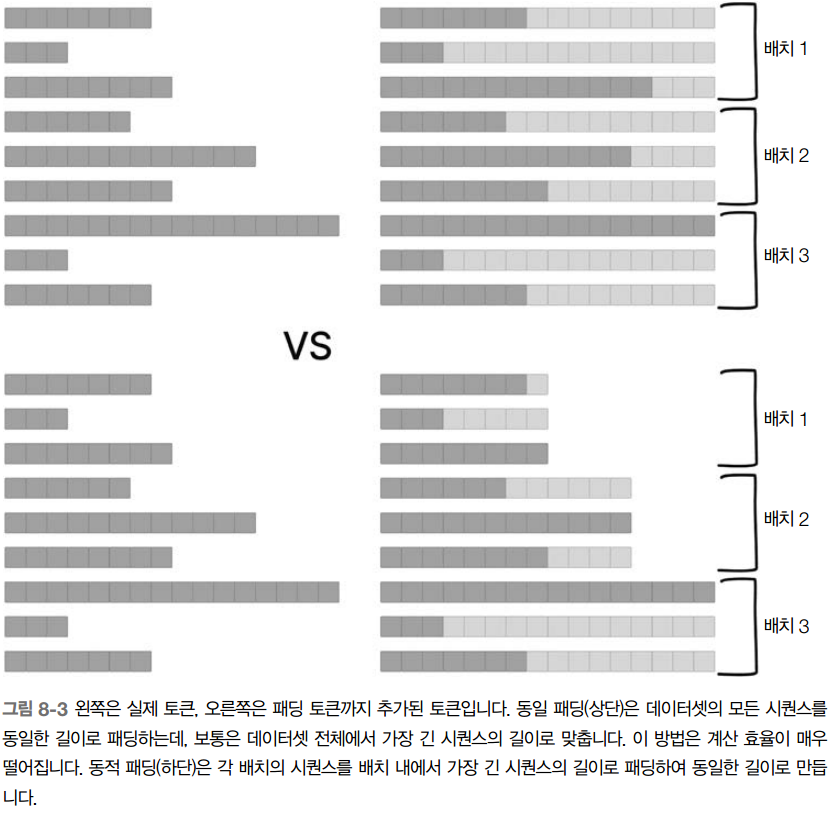

# 파운데이션 모델을 넘어서

-  기존 모델들을 결합하여 새로운 LLM 아키텍처를 구축

## 사례연구 VQA

- 시각적 질문-답변(visual question-answering(VQA))은 이미지와 자연어 모두에 대한 이해와 추론이 필요한 어려운 작업

## 사용 모델
### 텍스트 프로세서: DistillBERT
- DistilBERT는 속도와 메모리 효율성을 위해 최적화된 인기 있는 BERT 모델의 증류distilled 버전. 사전 훈련된 모델은 지식 증류(Knowledge Distillation)를 사용하여 더 큰 BERT 모델에서 더 작고 효율적인 모델로 지식을 전달
    - 머신 러닝에서 모델의 지식을 전달하는 방법으로 모델의 크기는 줄이되 중요한 부분을 남기는 방법
### 이미지 프로세서: ViT
- 비전 트랜스포머Vision Transformer(ViT)는 이미지 이해를 위해 특별히 설계된 트랜스포머 기반 아키텍처입니다. 이 모델은 이미지에서 관련된 특징을 추출하기 위해 셀프 어텐션(Self-Attention) 메커니즘을 사용    
- ViT를 사용할 때는 모델이 사전 훈련하는 동안 사용한 것과 동일한 이미지 전처리 단계를 사용하는 것이 좋으며 장단점이 존재
- 장점
    1. 사전 훈련과의 일관성: 사전 훈련 중에 사용된 것과 동일한 형식과 분포의 데이터를 사용하면 성능이 향상되고 수렴 속도가 빨라질 수 있다
    2. 사전 지식 활용: 모사전 훈련되었기 때문에 이미지에서 의미 있는 특징을 추출하는 방법을 이미 학습. 동일한 전처리 단계를 사용하면 모델이 이 사전 지식을 새 데이터셋에 효과적으로 적용
    3. 개선된 일반화: 사전 훈련과 일관된 전처리 단계를 사용하면 모델이 이미 다양한 이미지 구조와 특징을 본 적이 있기 때문에 새 데이터에 대해 더 잘 일반화될 가능성이 높다
- 단점
    1. 제한된 유연성: 동일한 전처리 단계를 재사용하면 모델이 새로운 데이터 분포나 새 데이터셋의 특성에 적
    응하는 능력이 제한될 수 있으며, 이는 최적의 성능을 위해 다른 전처리 기술이 필요
    2. 새 데이터와의 불일치: 새 데이터셋은 기존의 전처리 단계에 잘 맞지 않는 고유한 속성이나 구조를 가질 수 있으며, 이로 인해 전처리 단계가 해당 속성이나 구조에 맞게 조정되지 않는다면 성능이 떨어질 수 있다
    3. 사전 훈련 데이터에 대한 과적합: 동일한 전처리 단계에 지나치게 의존하면 모델이 사전 훈련 데이터의 특성에 과적합될 수 있다

### 은닉 상태(여기서는 딥러닝에서 은닉층hidden layer의 상태를 의미) 투영과 융합

- 들은 입력의 유용한 특징 표현을 포함하는 출력 텐서를 생성. 그러나 이러한 특징이 반드시 같은 형식으로 되지는 않으며, 차원 수가 다를 수도 있다
- 불일치 해결
    - 선형 투영(projection(사전적 의미는 도형이나 입체를 다른 평면에 옮기는 일입니다. 여기서는 어떤 벡터를 다른 벡터 위로 옮기는 것을 의미합니다)) 계층을 사용하여 텍스트와 이미지 모델의 출력 텐서를 공유 차원 공간에 투영. 이를 통해 텍스트와 이미지 입력에서 추출된 특징들을 결합. 
    - 디코더(GPT-2) 입력여 일관되고 관련 있는 텍스트 답변을 생성

### 크로스-어텐션: 이것은 무엇이며 왜 중요한가요?